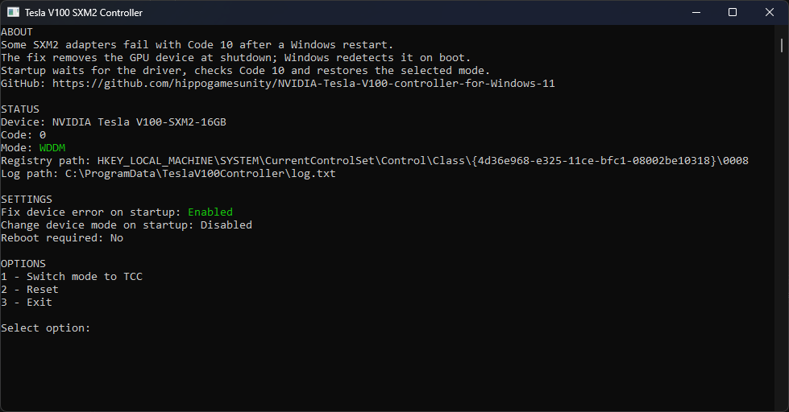

# Tesla V100 SXM2 Controller for Windows 11

A small console utility for **Tesla V100 SXM2 16/32 GB cards connected through a PCIe adapter**. Helps recover from **Code 10 after a Windows restart** and switch between **TCC and WDDM**.



## Symptoms

On the tested setup:

- **400-series drivers** install and work, but are incompatible with the tested LM Studio setup.
- **500-series drivers** can initially work, but the GPU reports **Code 10** after restarting Windows.
- **Standard driver mode switching** to WDDM fails or reports **Not Supported**, preventing use of the graphics mode.

## Test setup

- **GPU:** NVIDIA Tesla V100 SXM2, 16 GB.
- **Adapter:** Chinese SXM2-to-PCIe adapter with a rotary fan-speed control knob.
- **Cooling:** adapted RTX 4090 Phantom cooler.
- **OS:** Windows 11.
- **Current driver:** NVIDIA Data Center **582.99**, confirmed with `nvidia-smi`.

These observations apply to this setup; other adapters and driver versions may behave differently. The 32 GB SXM2 variant still needs hardware validation.

## Features

- Displays GPU status, driver mode and whether a reboot is required.
- Removes the GPU device at shutdown, keeping the NVIDIA driver installed, so Windows can detect it again on boot.
- Checks the GPU at startup, recovers persistent Code 10 with a guarded restart, and restores the selected mode.
- Switches TCC/WDDM by updating the GPU's driver registry settings and restarting the device.
- Resets controller settings and restores backed-up driver registry values.

Startup runs through Windows Task Scheduler as SYSTEM; no permanent Windows service is required.

## Usage

1. Download the EXE from [GitHub Actions artifacts](https://github.com/hippogamesunity/NVIDIA-Tesla-V100-controller-for-Windows-11/actions), or build it below.
2. Launch `TeslaV100Controller.exe` as administrator.
3. Select **Install fix** to enable startup recovery and the shutdown workaround.
4. Select **Switch mode to TCC/WDDM** if needed. Close GPU applications before switching.

**Reset** removes the installed fix and saved preferences, and restores original driver registry values (TCC defaults if no backup exists). Restart Windows if **Reboot required** says **Yes**.

The installed EXE is stored in `%ProgramFiles%\TeslaV100Controller`; settings and logs are in `%ProgramData%\TeslaV100Controller`.

Supports PCI IDs `10DE:1DB1` and `10DE:1DB5` only. Mode switching is a driver-specific workaround, verified with NVIDIA Data Center 582.99, rather than an officially supported universal solution.

## Build

Requires Windows and the **.NET 10 SDK**. In VS Code, use **Ctrl+Shift+B** to publish or **F5** to launch from an administrator VS Code window.

```powershell
dotnet publish src/TeslaV100Controller -c Release -r win-x64 --self-contained true -p:PublishSingleFile=true -p:IncludeNativeLibrariesForSelfExtract=true -p:EnableCompressionInSingleFile=true -o bin/Release
```

The resulting `bin/Release/TeslaV100Controller.exe` includes .NET. Run it with `--help` for command-line options.

Based on the [original Windows driver workaround](https://habr.com/ru/posts/1042620/).
